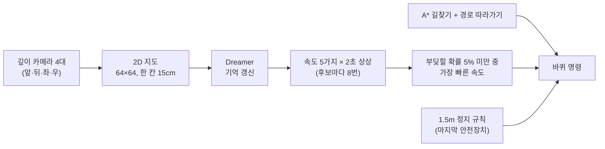

# 물류창고 AGV 월드모델 — 2초 뒤를 상상해 사람·지게차를 피하는 AGV

물류창고 AGV가 **2초 뒤를 미리 상상**해서, 부딪힐 것 같을 때만 미리 느려지게 만든 프로젝트입니다.
NVIDIA Isaac Sim 가상 창고에서 **일부러 부딪히는 장면까지 포함한 데이터**를 직접 만들고, DreamerV3 구조의 작은 월드모델을 처음부터 학습했습니다.

<p align="center">
  <br>
  <sub>처음 보는 창고, 같은 장면 · 같은 카메라. 왼쪽 <b>규칙</b>: 머뭇거리는 사람과 충돌 · 오른쪽 <b>Dreamer</b>: 멈춰서 기다렸다가 지나감 (같은 장면 7번 중 5번 이렇게 갈림)</sub>
</p>

| | 결과 (처음 보는 창고 5곳, 같은 270장면 × 2회 = 방법마다 540번) |
|---|---|
| **충돌 없이 도착** | 규칙 **91.3%** → Dreamer **93.7%** — 규칙만큼 안전 (짝 비교 p = 0.053, 경계선) |
| **제시간 도착** | 규칙 **28.3%** → Dreamer **33.9%** — 확실히 빠름 (짝 비교 p = 0.0002) |
| **먼저 도착** | 둘 다 도착한 480번 중 **334번** Dreamer가 먼저 (중앙값 2.6초 빠름) |
| **충돌 예측 (AUROC)** | 처음 보는 창고 **0.94~0.99** (거리만 보는 방식 0.81~0.88) |
| **모델 크기 · 속도** | 가중치 **1,450만 개 (58MB)** · 한 번 판단 **0.044초** (Jetson AGX Orin) |

---

## 목차
1. [왜 만들었나](#1-왜-만들었나)
2. [먼저 Cosmos를 써 봤다 — 실패](#2-먼저-cosmos를-써-봤다--실패)
3. [시스템 한눈에](#3-시스템-한눈에)
4. [가상 창고와 AGV](#4-가상-창고와-agv)
5. [깊이 카메라 → 2D 지도](#5-깊이-카메라--2d-지도)
6. [학습 데이터](#6-학습-데이터)
7. [Dreamer 모델과 학습](#7-dreamer-모델과-학습)
8. [상상으로 속도 고르기](#8-상상으로-속도-고르기)
9. [결과](#9-결과)
10. [영상 모음](#10-영상-모음)
11. [한계](#11-한계)
12. [다음 할 일](#12-다음-할-일)
13. [폴더 구조와 실행 방법](#13-폴더-구조와-실행-방법)
14. [관련 연구](#14-관련-연구)

자세한 식은 [docs/수식노트.html](docs/수식노트.html) (내려받아 브라우저로 열기)에 쉬운 말 설명과 함께 정리했습니다.

---

## 1. 왜 만들었나

지금 AGV는 대부분 **"앞에 무언가 보이면 멈춘다"**는 규칙으로 움직입니다. 랙 사이에서 사람이 갑자기 나오거나 지게차가 다가오면, 알아챘을 때는 이미 늦습니다.
그래서 **지금 상태와 행동을 넣으면 미래를 예측하는 AI(월드모델)**로 AGV가 2초 뒤를 상상하게 하고, 위험할 때만 미리 속도를 줄이게 했습니다.

## 2. 먼저 Cosmos를 써 봤다 — 실패

<p align="center"><br>
<sub>왼쪽 실제: 그대로 가면 부딪힘 · 오른쪽 Cosmos의 상상: 통이 같이 물러남</sub></p>

NVIDIA의 범용 월드모델 **Cosmos 3 Nano**를 Jetson AGX Orin에서 돌려, 그대로 가면 반드시 부딪히는 장면 50개로 시험했습니다.

| 시험 | 결과 |
|---|---|
| 부딪히는 미래를 그렸나 | **50번 중 0번** — 앞의 물체가 같이 물러나는 "아무 일 없는 미래"를 그림 |
| 명령대로 움직이나 (배경만 비교) | 50번 중 50번 — 움직임은 이해함 |
| 우리 충돌 영상으로 추가 학습 | 10번 중 3번 |
| 상상 한 번에 걸린 시간 | **72초** (AGV는 0.2초마다 판단해야 함) |

- **낙관 편향:** 일반 영상으로 "그럴듯한 미래"를 배웠는데, 그런 영상에는 사고 장면이 거의 없어 충돌하는 미래를 그리지 않습니다.
- **느림:** 영상 전체를 20번 다듬어 그리는 방식이라 실시간 판단에 쓸 수 없습니다.

→ 그래서 **사고 데이터를 직접 만들고, 영상 대신 작은 상태로 미래를 예측하는 Dreamer**로 바꿨습니다. 원인 분석은 [docs/cosmos/](docs/cosmos/)에 있습니다.

## 3. 시스템 한눈에



0.2초마다 반복합니다. 방향은 A* 길찾기가, 속도의 상한은 Dreamer가 정하고, 실제 속도는 커브·가속 제한·정지 규칙 중 가장 낮은 값입니다.

## 4. 가상 창고와 AGV

| 항목 | 내용 |
|---|---|
| 시뮬레이터 | NVIDIA Isaac Sim 6.1 (RTX 5090) |
| 창고 | **14곳** — 학습용 9곳(자동 생성 8 + Isaac 기본 1), 시험용 5곳(쿠팡·아마존식 FC + 자동 생성 101~104, 학습에 한 번도 안 씀) |
| AGV | idealworks iw.hub (2바퀴 차동 구동), 최고 1.0m/s |
| 센서 | 깊이 카메라 4대 (가로 120°), 바닥 QR로 위치 오차 보정 |
| 처음 아는 지도 | 랙·벽만 (사람·지게차·바닥 물건은 가서 봐야 앎) |
| 위험 상황 | 13가지 — 가로지르기, 랙 사이에서 나오기, 머뭇거리기, 멈췄다 걷기, 마주 오기, 따라오기, 방향 꺾는 지게차, 길 막고 선 지게차, 떨어진 상자 등 |
| 사람·지게차 움직임 | 서서히 가속·감속, 둥글게 돌기, 양보 (사람 최고 1.4m/s, 지게차 2.0m/s) |
| 비교 대상 (규칙) | 앞 1.5m 안에 무언가 있으면 정지, 3m 안이면 0.35m/s로 감속 |

<p align="center"></p>

**길찾기:** 0.1m 칸 지도에서 A*로 가장 짧은 길(장애물에서 0.7m 이상)을 찾고, 0.8m 앞 경로 점을 향해 원을 그리며 따라갑니다. 같은 자리에 장애물이 1초 넘게 보이면 지도에 넣고 그 자리에서 다시 찾습니다.

<p align="center"></p>

## 5. 깊이 카메라 → 2D 지도

<p align="center"></p>

1. **점마다 실제 위치:** 깊이 카메라는 점마다 거리(m)를 줍니다. 카메라 위치·방향을 알기 때문에 AGV 기준 앞·옆·높이를 계산합니다.
2. **높이로 나누기:** 바닥 위 **0.1~1m = 장애물(초록)**, 바닥 = 지나갈 수 있는 곳(파랑), 그보다 높거나 5m 밖은 버림.
3. **위에서 내려다보기:** 높이를 지우고 AGV 중심 **64×64 칸(한 칸 0.15m, 9.6m 정사각형)**에 찍습니다. 앞 6.6m · 뒤 3m · 좌우 4.8m.
4. 칸에 점이 **하나라도** 있으면 칠합니다(개수 문턱 없음). 카메라 4대를 합쳐 0.2초마다 한 장.

| 실제 장면 (참고) | 깊이 카메라 원래 화면 | Dreamer가 보는 2D 지도 |
|---|---|---|
|  |  |  |

왜 2D 지도인가: AGV는 바닥 위에서만 움직이니 충돌은 "바닥 어디에 무엇이 있나"로 정해지고, 색·조명이 지워져 처음 보는 창고에도 그대로 통합니다.

## 6. 학습 데이터

| 항목 | 값 |
|---|---|
| 창고 | 학습용 9곳 |
| 주행 | **2,305번** (출발 → 도착 또는 충돌, 최대 60초) · 검증용 231번 제외하고 2,074번으로 학습 |
| 0.2초 칸 | **535,174칸** (약 30시간) |
| 충돌로 끝난 주행 | **752번** |
| 운전 방식 | 규칙대로 피하기 35% · 속도 무작위 50% (0·0.3·0.6·1배를 0.8~2.5초마다) · 피하지 않기 15% |
| 한 칸에 담긴 것 | 2D 지도 + 그 0.2초의 행동(전진 m/s, 회전 rad/s) + 부딪혔나 |

속도를 무작위로 바꾼 주행을 섞은 이유: 같은 상황에서 **속도마다 부딪히는지 안 부딪히는지**를 봐야 "이 속도로 가면 부딪힌다"를 배울 수 있기 때문입니다. 목적지까지 길이 아예 없는 장면은 뺐습니다.

## 7. Dreamer 모델과 학습

DreamerV3([Hafner 외](https://arxiv.org/abs/2301.04104))의 **월드모델 구조만 가져와 처음부터 학습**했습니다. 원래의 보상(점수) 예측 자리에 **충돌 예측**을 넣었습니다.

| 부분 | 하는 일 | 가중치 수 |
|---|---|---|
| 인코더 | 2D 지도 → 작은 숫자 묶음 | 69만 |
| 기억·상상 (RSSM: GRU 512 + 32×32 범주형 상태) | 지난 장면·행동을 쌓고, 지도를 안 보고 다음 상태 예측 | 578만 |
| 디코더 | 상태로 지도를 다시 그림 (학습 확인용) | 699만 |
| 충돌 머리 | 그 순간 부딪힐 확률 | 105만 |
| **합계** | | **14,504,324 (58MB)** |

**학습 목표:** 지도 복원 오차 + 2 × 충돌 예측 오차 + (보기 전 예측 ↔ 실제로 본 상태) 차이.
마지막 항 덕분에 학습이 끝나면 **지도를 안 보고도 다음을 맞히는 "상상"**이 됩니다.

$$\mathcal{L} = \sum (\hat x_t - x_t)^2 + 2\,\mathrm{BCE}(c_t, y_t) + 0.5\,\max\!\big(1, \mathrm{KL}[\mathrm{sg}(q)\,\|\,p]\big) + 0.1\,\max\!\big(1, \mathrm{KL}[q\,\|\,\mathrm{sg}(p)]\big)$$

4.8초(24칸) 조각 16개씩 40,000번, RTX 5090에서 76분. 충돌로 끝난 주행은 30% 확률로 충돌 순간이 든 마지막 조각을 뽑아 드문 충돌을 자주 보게 했습니다. 검증 AUROC가 가장 좋은 22,000번째 모델을 씁니다.

## 8. 상상으로 속도 고르기

<p align="center"><br>
<sub>사람이 앞을 막자 "그대로 가면 위험 22%" → 멈추고 물러나 사람을 먼저 보냄 (전체 영상: <a href="media/videos/panel_dreamer_person_s101.mp4">panel_dreamer_person_s101.mp4</a>)</sub></p>

0.2초마다:
1. 새 2D 지도와 방금 행동으로 기억을 갱신합니다.
2. 속도 후보 **5가지(1.0 · 0.6 · 0.3 · 0 · 후진 0.3 m/s)**마다 "지금 경로를 그 속도 이하로 따라가면"을 **2초(10칸)** 상상합니다. 미래가 여러 갈래일 수 있어 후보마다 **8번** 상상해 평균합니다.
3. 칸마다 나온 충돌 확률을 합쳐 **"2초 안에 한 번이라도 부딪힐 확률"** = 1 − (칸마다 안 부딪힐 확률의 곱).
4. 학습 때 충돌을 강조해 확률이 높게 나오므로, 검증 데이터로 맞춘 보정식(Platt)으로 실제 비율에 맞춥니다.
5. **5% 미만 중 가장 빠른 속도**로 갑니다. 모두 위험하면 가장 오래 버티는 속도. 1.5m 정지 규칙은 마지막 안전장치로 유지합니다.

판단 시간: RTX 5090(시뮬레이터와 함께) 0.11초 · **Jetson AGX Orin 0.044초**.

## 9. 결과

### 최종 시험 — 처음 보는 창고 5곳, 같은 270장면 × 2회

| | 대응 없음 (참고) | 규칙 | **Dreamer** |
|---|---|---|---|
| 주행 수 | 360 | 540 | 540 |
| 충돌 없이 도착 | 18 | 493 (91.3%) | **506 (93.7%)** |
| 제시간 도착 | 18 | 153 (28.3%) | **183 (33.9%)** |
| 사람·물체 충돌 / 랙 충돌 | 318 / 24 | 29 / 12 | **24 / 7** |
| 시간 초과 | 0 | 6 | 3 |

- 상황별 충돌 없이 도착 (각 180번): 평소 통행 165 → 168 · 갑자기 덮침 160 → 166 · 통로 막힘 168 → 172
- **같은 장면 짝 비교:** 충돌 없이 도착 — 규칙만 성공 13 · Dreamer만 성공 26 (McNemar p = 0.053) / 제시간 — 17 대 47 (p = 0.0002)
- 둘 다 도착한 480번 중 334번 Dreamer가 먼저 (부호 검정 p < 10⁻¹⁸) — **위험할 때만 느려지기 때문**
- 재현성: 두 번 돌려 결과가 같았던 장면 규칙 251 · Dreamer 258 / 270
- 제시간 = 처음 계획한 경로를 0.7m/s로 달린 시간 + 10초 안에 도착

**정리: 규칙만큼 안전하고(통계적으로 경계선), 확실히 더 빨리 도착합니다.** 원본 수치: [results/v5c/](results/v5c/)

### 충돌 예측 능력 (AUROC, 2초 안 충돌)

| 데이터 | Dreamer | 거리 기준 (앞 통로 가장 가까운 장애물) |
|---|---|---|
| 학습 창고 검증 231편 | 0.948 | 0.864 |
| FC — 쿠팡·아마존식 (처음 봄) 40편 | 0.979 | 0.805 |
| 생성 101 (처음 봄) 40편 | 0.939 | 0.869 |
| 생성 102 (처음 봄) 40편 | 0.988 | 0.883 |

1 = 완벽하게 가려냄, 0.5 = 찍기. 처음 보는 창고에서도 떨어지지 않아 **일반화가 된다**는 근거입니다.

## 10. 영상 모음

같은 장면을 규칙과 Dreamer로 달려 바닥 고정 카메라로 찍은 비교 영상입니다. 같은 장면도 판단 시간에 따라 결과가 조금씩 달라서 **재현 횟수**를 함께 적었습니다.

| 영상 | 상황 | 재현 |
|---|---|---|
| [rule_vs_dreamer_forklift_s103.mp4](media/videos/rule_vs_dreamer_forklift_s103.mp4) | 방향을 꺾어 오는 지게차 — 규칙은 받힘, Dreamer는 일찍 멈춰 보내고 지나감 | 4번 중 4번 |
| [rule_vs_dreamer_person_s101.mp4](media/videos/rule_vs_dreamer_person_s101.mp4) | 건너다 머뭇거리는 사람 | 7번 중 5번 (반대 1번) |
| [rule_vs_dreamer_person_s102.mp4](media/videos/rule_vs_dreamer_person_s102.mp4) | 작업자 여럿 사이, 멈췄다 걷는 사람 | 4번 중 2번 (반대 1번) |
| [rule_vs_dreamer_forklift_s104.mp4](media/videos/rule_vs_dreamer_forklift_s104.mp4) | 길을 막고 선 지게차 포크 — 규칙 6/6 충돌, Dreamer 6/6 무충돌(4번 도착) | |
| [rule_vs_dreamer_s102_chase.mp4](media/videos/rule_vs_dreamer_s102_chase.mp4) | 랙 사이에서 나온 사람 (뒤따르는 카메라, 중간발표 10장) | 최종 시험 1회차 기록 — 다시 돌리면 대부분 둘 다 충돌 (재현 낮음, 10번 중 1번) |
| [panel_dreamer_person_s101.mp4](media/videos/panel_dreamer_person_s101.mp4) / [panel_rule_person_s101.mp4](media/videos/panel_rule_person_s101.mp4) | 출발~도착 전체 + 깊이 · 2D 지도 · 상상 · 속도별 위험 · 길찾기 지도 | |
| [depth_to_bev_to_dreamer.mp4](media/videos/depth_to_bev_to_dreamer.mp4) | 깊이 → 3D 점 → 2D 지도 → Dreamer 입력 → 상상 애니메이션 (실제 데이터·실제 모델 출력) | |
| [cosmos_fail_real_vs_imagined.mp4](media/videos/cosmos_fail_real_vs_imagined.mp4) · [rule_collision.mp4](media/videos/rule_collision.mp4) | Cosmos 실패 · 규칙의 충돌 | |

<p align="center"></p>

## 11. 한계

- **충돌 없이 도착의 차이는 통계적으로 경계선**(p = 0.053)입니다. "더 안전하다"가 아니라 "규칙만큼 안전하고 더 빠르다"가 정확합니다.
- **안전장치 없이 Dreamer만** 쓴 이전 버전은 규칙보다 성공이 적었습니다(162장면 중 130 대 145, p = 0.011). 그래서 최종은 Dreamer(속도) + 1.5m 정지(마지막 안전장치)입니다.
- **후진 데이터가 적습니다** (53만 칸 중 0.6%, 주로 좁은 곳에서 빠져나올 때). 후진 후보의 위험은 다른 속도보다 덜 정확할 수 있습니다.
- 시뮬레이터 깊이는 잡음이 없습니다. 실제 카메라에서는 잡음·빈 값 처리가 필요합니다.
- 속도 결정만 학습했고, 방향은 A*가 정합니다.
- 최종 시험에는 "상대 속도를 아는 기준선(등속 예측·TTC)"이 없습니다. 초기 단순 창고 실험에서만 비교했습니다(가로지르는 사람 30번 중 등속 예측 15 · Dreamer 29).

## 12. 다음 할 일

- **모델 고도화:** 속도를 아는 기준선(TTC)과 비교 · 위험 기준·상상 길이 곡선 · 남은 실패 분석 · 후진·회전 데이터 보강 · 방향까지 상상 속에서 학습(원래 Dreamer 방식)
- **소형 실차 (RC카):** 아두이노 2바퀴 로봇카 + Jetson Xavier NX + RealSense D435. 차 위에서는 깊이 → 2D 지도만 만들고(약 1KB), Dreamer 계산은 와이파이로 외부 Jetson에서 하는 구성도 가능. 초음파 센서는 아두이노 안에서 비상 정지.
- **Cosmos는 '그리는 역할'로:** Dreamer가 상상한 지도를 실제 같은 영상으로 바꿔 설명·데모

## 13. 폴더 구조와 실행 방법

```
isaac/            Isaac Sim 코드
  build_wh.py       창고 자동 생성 (seed → warehouse.usda + env.json)
  build_fc.py       쿠팡·아마존식 FC 창고
  logistics.py      시험장 전체: 지도 만들기 · 위험 상황 · 데이터 수집 · 평가 · 데모 · 영상
  nav.py            A* 길찾기 · 경로 따라가기 · 2D 지도(bev) · 정지 규칙
src/
  wm_bev.py         Dreamer 학습 · 평가 · 주행 중 앞보기(Lookahead)
  rollout.py 외      Cosmos 실험 코드 (2절)
third_party/dreamerv3-torch/   DreamerV3 PyTorch 구현 (MIT, NM512)
scripts/vm/       실제로 쓴 실행 스크립트 (수집 job17 · 학습 chain17 · 평가 job18 · 데모 demo.sh · 영상)
scripts/media/    영상·애니메이션 만드는 코드
results/          결과 요약 (README · 수치 json · 학습 기록)
docs/             수식 노트 · Cosmos 실험 기록
media/            영상 · GIF · 그림
```

**환경:** Ubuntu + NVIDIA RTX GPU, Isaac Sim 6.1 (pip 가상환경), PyTorch, numpy, scipy, pyyaml, pillow, matplotlib, ffmpeg.

```bash
# 1) 창고 만들기 + 지도 (랙·벽만 아는 처음 지도 포함)
python isaac/build_wh.py --seed 1 --out ~/agv/wh/s001
python isaac/logistics.py --inspect --env ~/agv/wh/s001/env.json --out ~/agv/wh/s001
python isaac/logistics.py --inspect --racks-only --env ~/agv/wh/s001/env.json --out ~/agv/wh/s001

# 2) 학습 데이터 수집 (창고마다, 길 없는 장면 제외)
python isaac/logistics.py --v5 --collect5 260 --first 11000 --env ~/agv/wh/s001/env.json --out ~/agv/wh/s001 \
    --map racks --swept --smooth --backout --real-motion --reach --data-dir wm_data5c

# 3) 학습 (모든 창고의 ep*.npz를 한 폴더에 모아서)
python src/wm_bev.py --train --data ~/agv/v5cdata --out ~/agv/wm_bev_v5c --steps 40000 \
    --cont-scale 2 --term-frac 0.3 --chan-off R --cams 4 --bev-margin 0 --val-max 100

# 4) 평가 (처음 보는 창고, 규칙과 Dreamer를 같은 장면으로)
python isaac/logistics.py --v5 --eval5 --backout --swept --smooth --real-motion --env ~/agv/wh/s101/env.json \
    --out ~/agv/wh/s101 --map racks --conds respond,wm --wm-ckpt models/wm_22000.pt \
    --hybrid --pathcand --escape --hyb-slow 2.5:0.6 --tau 0.05 --tag _final

# 5) 직접 해 보기 (창고·출발·목적지·상황을 골라 한 번 주행, 실시간 보기는 AGV_STREAM_IP 설정)
bash scripts/vm/demo.sh
```

**학습된 가중치·맛보기 데이터:** [Release v0.1-midterm](https://github.com/KINN-CH/agv-dreamer-warehouse/releases/tag/v0.1-midterm)
- `agv-dreamer-v5c-model.zip` — `wm_22000.pt` + `config.json` + `train_log.json`(확률 보정값). 풀어서 `models/`에 둡니다.
- `agv-dreamer-sample-data.zip` — 학습 데이터 맛보기 10편(충돌 5 · 무충돌 5, 창고 s003). 전체 2,305편은 위 수집 명령으로 다시 만들 수 있습니다.

```python
from pathlib import Path
import numpy as np, sys
sys.path.insert(0, "src")
import wm_bev
la = wm_bev.Lookahead(Path("models/wm_22000.pt"))       # config.json · train_log.json이 같은 폴더에
la.observe(bev, np.array([v, w], np.float32))            # 0.2초마다: 64×64×3 지도와 그 0.2초의 평균 행동
risks = la.risks([(s, 0.0) for s in (1.0, 0.6, 0.3, 0.0, -0.3)])   # 속도별 (2초 안 충돌 확률, 충돌까지 기대 시간)
```

## 14. 관련 연구

- **DreamerNav** (UCL, *Frontiers in Robotics and AI*, 2025) — DreamerV3 + Isaac Sim 창고에서 4족 로봇의 주행 정책을 상상 속에서 학습. 가장 가까운 연구입니다. 우리는 길찾기는 그대로 두고 **충돌 확률로 속도만 정하는 안전 층**으로 붙였고, 충돌 데이터를 일부러 만들었으며, 실제 같은 사람·지게차가 있는 처음 보는 창고 5곳에서 규칙과 같은 장면끼리 비교했습니다. [논문](https://www.frontiersin.org/journals/robotics-and-ai/articles/10.3389/frobt.2025.1655171/full)
- **DreamerV3** (Hafner 외, 2023) — 구조의 출발점. [arXiv](https://arxiv.org/abs/2301.04104) · 구현 [NM512/dreamerv3-torch](https://github.com/NM512/dreamerv3-torch)
- **DREAMer-VXS** (2025) — 지상 차량 LiDAR 탐사용 잠재 월드모델. [arXiv](https://arxiv.org/abs/2512.00005)
- **SafeDrive Dreamer** (2024) — 자율주행 위험 상황과 월드모델. [논문](https://www.sciencedirect.com/science/article/pii/S1110016824011943)
- **NVIDIA Cosmos** — 범용 월드 파운데이션 모델 (2절에서 시험)

---

## 팀

김철호 · 김준경 · 김민서 · 정윤찬

<sub>2026년 2학기 졸업 프로젝트 중간발표(10/12) 기준 결과입니다. 수치는 모두 위 폴더의 원본 기록에서 계산했습니다.</sub>
