# 월드모델 기반 물류창고 AGV 충돌 예측 및 속도 제어

본 프로젝트는 물류창고 AGV가 **2초 후의 상황을 월드모델로 예측**하고, 충돌 위험이 있을 때에만 사전에 감속하도록 하는 안전 제어 시스템입니다.
NVIDIA Isaac Sim 가상 창고에서 **충돌 장면을 포함한 학습 데이터**를 직접 생성하였으며, DreamerV3 구조의 월드모델을 해당 데이터로 처음부터 학습하였습니다.

<p align="center">
  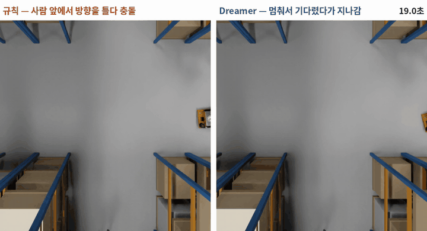<br>
  <sub>학습에 사용하지 않은 창고, 동일 장면 · 동일 카메라. 왼쪽 <b>규칙 기반</b>: 머뭇거리는 보행자와 충돌 · 오른쪽 <b>Dreamer</b>: 정지 후 대기, 통과 (동일 장면 7회 중 5회 재현)</sub>
</p>

| 항목 | 결과 (미학습 창고 5곳, 동일 270장면 × 2회 = 방법별 540회) |
|---|---|
| **무충돌 도착률** | 규칙 기반 **91.3%** → Dreamer **93.7%** — 규칙 기반과 동등한 안전성 (대응 비교 p = 0.053, 유의 경계) |
| **제시간 도착률** | 규칙 기반 **28.3%** → Dreamer **33.9%** — 유의하게 향상 (대응 비교 p = 0.0002) |
| **선도착** | 양쪽 모두 도착한 480회 중 **334회** Dreamer가 먼저 도착 (중앙값 2.6초 단축) |
| **충돌 예측 (AUROC)** | 미학습 창고 **0.94~0.99** (거리 기준 방식 0.81~0.88) |
| **모델 규모 · 추론 시간** | 파라미터 **14,504,324개 (58MB)** · 1회 판단 **0.044초** (Jetson AGX Orin) |

---

## 목차
1. [연구 배경 및 목표](#1-연구-배경-및-목표)
2. [사전 실험: NVIDIA Cosmos 적용 결과](#2-사전-실험-nvidia-cosmos-적용-결과)
3. [시스템 구조도](#3-시스템-구조도)
4. [시뮬레이션 환경](#4-시뮬레이션-환경)
5. [BEV 지도 변환](#5-bev-지도-변환)
6. [학습 데이터 구성](#6-학습-데이터-구성)
7. [월드모델 구조 및 학습](#7-월드모델-구조-및-학습)
8. [예측 기반 속도 결정](#8-예측-기반-속도-결정)
9. [실험 결과](#9-실험-결과)
10. [주행 영상](#10-주행-영상)
11. [한계점](#11-한계점)
12. [향후 계획](#12-향후-계획)
13. [저장소 구조 및 실행 방법](#13-저장소-구조-및-실행-방법)
14. [관련 연구](#14-관련-연구)

전체 수식과 각 수식의 의미는 [docs/수식노트.html](docs/수식노트.html)(내려받은 뒤 브라우저에서 열람)에 정리되어 있습니다.

---

## 1. 연구 배경 및 목표

현재 대부분의 AGV는 **"전방에 물체가 감지되면 정지한다"**는 거리 기반 규칙으로 동작합니다. 이 방식은 현재 거리만 고려하므로, 랙 사이에서 갑자기 나타나는 보행자나 접근하는 지게차에 대해 대응이 늦어집니다.
본 프로젝트는 **현재 상태와 행동으로부터 미래를 예측하는 모델(월드모델)**을 사용하여 AGV가 2초 후의 상황을 예측하고, 충돌 위험이 있을 때에만 사전에 감속하도록 하는 것을 목표로 합니다.

## 2. 사전 실험: NVIDIA Cosmos 적용 결과

<p align="center">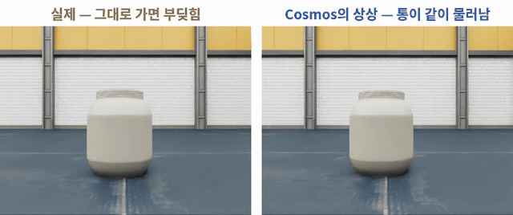<br>
<sub>왼쪽 실제 결과: 현재 속도 유지 시 충돌 · 오른쪽 Cosmos 예측: 물체가 함께 물러남</sub></p>

NVIDIA의 범용 월드모델 **Cosmos 3 Nano**를 Jetson AGX Orin에서 실행하여, 현재 속도를 유지하면 반드시 충돌하는 장면 50개로 평가하였습니다.

| 평가 항목 | 결과 |
|---|---|
| 충돌 장면 생성 | **50회 중 0회** — 전방 물체가 함께 물러나는, 충돌이 없는 미래를 생성 |
| 명령 추종 (배경 이동 비교) | 50회 중 50회 — 이동 명령은 정상 반영 |
| 자체 충돌 영상으로 추가 학습 후 | 10회 중 3회 |
| 1회 예측 소요 시간 | **72초** (AGV는 0.2초 주기 판단 필요) |

- **낙관 편향:** 일반 영상으로 학습된 모델이며, 학습 영상에 사고 장면이 거의 없어 충돌하는 미래를 생성하지 않습니다.
- **추론 속도:** 영상 전체를 20단계에 걸쳐 생성하는 확산 방식으로, 실시간 판단에 사용할 수 없습니다.

→ 이에 따라 **충돌 데이터를 직접 생성하고, 영상 대신 압축된 잠재 상태로 미래를 예측하는 Dreamer**로 방향을 전환하였습니다. 원인 분석은 [docs/cosmos/](docs/cosmos/)에 정리되어 있습니다.

## 3. 시스템 구조도

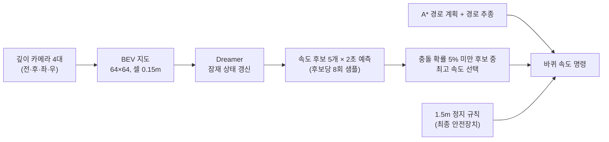

전체 과정은 0.2초 주기로 반복됩니다. 진행 방향은 A* 경로 계획이 결정하고, 속도 상한은 Dreamer가 결정합니다. 최종 속도는 곡률 제한·가속 제한·정지 규칙이 정한 값 중 최솟값입니다.

## 4. 시뮬레이션 환경

| 항목 | 내용 |
|---|---|
| 시뮬레이터 | NVIDIA Isaac Sim 6.1 (RTX 5090) |
| 창고 | **14곳** — 학습용 9곳(자동 생성 8 + Isaac 기본 1), 평가용 5곳(풀필먼트 센터형 FC + 자동 생성 101~104, 학습에 미사용) |
| AGV | idealworks iw.hub (2바퀴 차동 구동), 최고 1.0m/s |
| 센서 | 깊이 카메라 4대 (수평 화각 120°), 바닥 QR 코드로 위치 오차 보정 |
| 사전 지도 | 랙·벽만 포함 (보행자·지게차·바닥 적재물은 주행 중 감지) |
| 위험 상황 | 13종 — 횡단, 랙 사이 출현, 머뭇거림, 정지 후 재보행, 정면 접근, 후방 추종, 방향 전환 지게차, 통로 점유 지게차, 낙하 상자 등 |
| 보행자·지게차 거동 | 점진적 가감속, 곡선 회전, 양보 (보행자 최고 1.4m/s, 지게차 2.0m/s) |
| 비교 기준 (규칙 기반) | 전방 1.5m 이내 물체 감지 시 정지, 3m 이내 시 0.35m/s로 감속 |

<p align="center">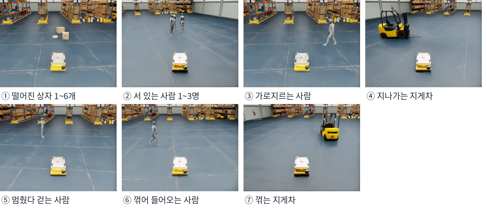</p>

**경로 계획:** 0.1m 격자 지도에서 A*로 최단 경로(장애물과 0.7m 이상 이격)를 계산하고, 0.8m 전방 경로점을 추종하는 Pure Pursuit 방식으로 주행합니다. 같은 위치에서 장애물이 1초 이상 감지되면 지도에 반영하고 해당 위치에서 경로를 재계획합니다.

<p align="center">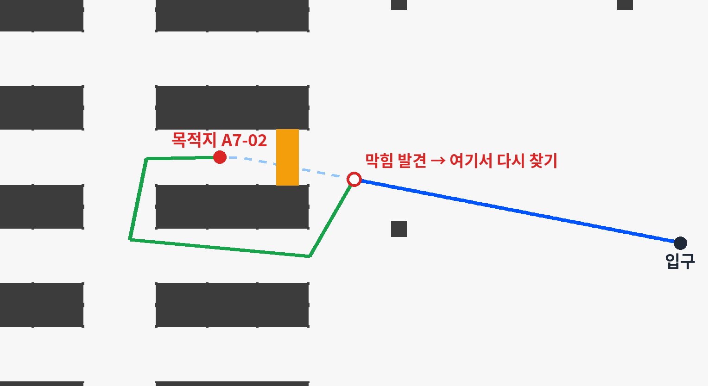</p>

## 5. BEV 지도 변환

<p align="center">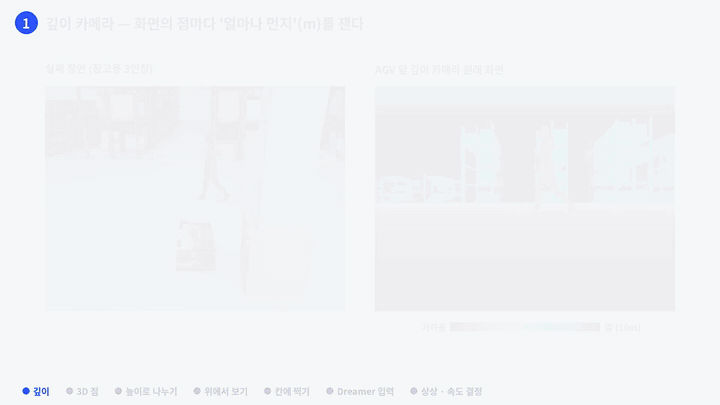</p>

깊이 영상을 위에서 내려다본 2차원 지도(BEV, Bird's-Eye View)로 변환하여 Dreamer의 입력으로 사용합니다.

1. **3차원 좌표 계산:** 깊이 카메라는 화소마다 거리(m)를 제공합니다. 카메라의 장착 위치와 방향을 알고 있으므로, 각 화소를 AGV 기준 전방·측방·높이 좌표로 변환합니다.
2. **높이 기준 분류:** 바닥으로부터 **0.1~1m 높이 = 장애물(G 채널)**, 바닥 = 주행 가능 영역(B 채널)으로 분류하고, 그보다 높거나 5m를 넘는 점은 제외합니다.
3. **평면 투영:** 높이 정보를 제거하고 AGV 중심 **64×64 격자(셀 0.15m, 9.6m 정사각형)**에 투영합니다. 범위는 전방 6.6m · 후방 3m · 좌우 각 4.8m입니다.
4. 셀 안에 점이 **1개 이상** 있으면 해당 셀을 표시합니다(개수 임계값 없음). 카메라 4대의 결과를 합쳐 0.2초마다 1장을 생성합니다.

| 실제 장면 (참고) | 깊이 카메라 원본 영상 | Dreamer 입력 BEV 지도 |
|---|---|---|
| 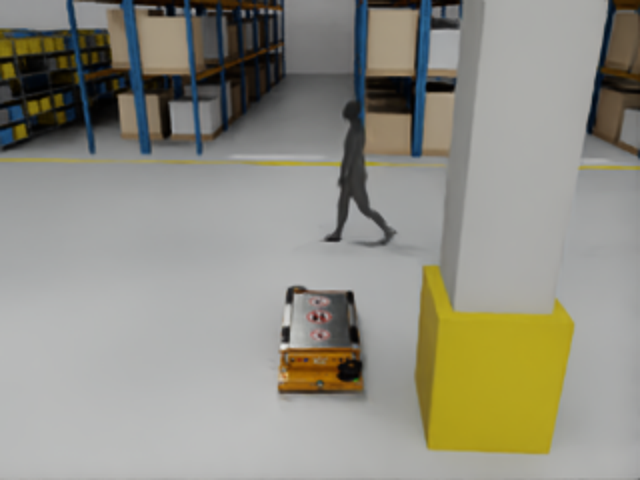 | 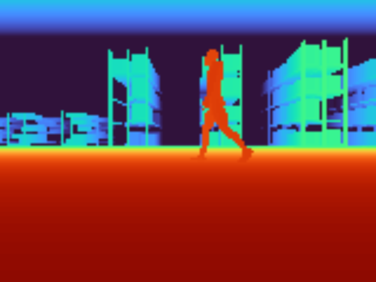 | 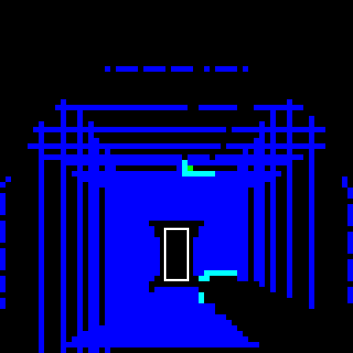 |

**BEV를 사용하는 이유:** AGV는 바닥 평면에서만 이동하므로 충돌 여부는 "바닥 위 어느 위치에 무엇이 있는가"로 결정됩니다. 또한 색상·조명 정보가 제거되어 미학습 창고에도 동일하게 적용할 수 있습니다.

## 6. 학습 데이터 구성

| 항목 | 값 |
|---|---|
| 창고 | 학습용 9곳 |
| 에피소드 | **2,305개** (출발 → 도착 또는 충돌, 최대 60초) · 검증용 231개를 제외한 2,074개로 학습 |
| 시간 단계 (0.2초) | **535,174단계** (약 30시간) |
| 충돌로 종료된 에피소드 | **752개** |
| 주행 정책 구성 | 규칙 기반 회피 35% · 무작위 속도 50% (최고 속도의 0·0.3·0.6·1배를 0.8~2.5초마다 변경) · 회피 없음 15% |
| 단계별 저장 항목 | BEV 지도 + 해당 0.2초의 행동(전진 속도 m/s, 회전 속도 rad/s) + 충돌 여부 |

**무작위 속도 주행을 포함한 이유:** 같은 상황에서 **속도에 따라 충돌 여부가 달라지는 사례**가 있어야 모델이 "이 속도로 진행하면 충돌한다"는 관계를 학습할 수 있습니다. 목적지까지 경로가 존재하지 않는 에피소드는 제외하였습니다.

## 7. 월드모델 구조 및 학습

DreamerV3([Hafner 외](https://arxiv.org/abs/2301.04104))의 **월드모델 구조를 사용하여 처음부터 학습**하였습니다. 원 구조의 보상 예측 헤드 대신 **충돌 예측 헤드**를 사용합니다.

| 구성 요소 | 역할 | 파라미터 수 |
|---|---|---|
| 인코더 | BEV 지도 → 특징 벡터 | 690,624 |
| RSSM (GRU 512 + 32×32 범주형 잠재 상태) | 과거 관측·행동을 누적하고, 관측 없이 다음 상태를 예측 | 5,776,896 |
| 디코더 | 잠재 상태로부터 BEV 지도 복원 (학습 신호용) | 6,985,667 |
| 충돌 예측 헤드 | 해당 시점의 충돌 확률 출력 | 1,051,137 |
| **합계** | | **14,504,324 (58MB)** |

**손실 함수:** 지도 복원 오차 + 2 × 충돌 예측 오차 + (관측 전 예측 상태 ↔ 관측 후 상태)의 KL 발산.
마지막 항을 통해 모델은 **관측 없이도 다음 상태를 예측(상상)**할 수 있게 됩니다.

$$\mathcal{L} = \sum (\hat x_t - x_t)^2 + 2\,\mathrm{BCE}(c_t, y_t) + 0.5\,\max\!\big(1, \mathrm{KL}[\mathrm{sg}(q)\,\|\,p]\big) + 0.1\,\max\!\big(1, \mathrm{KL}[q\,\|\,\mathrm{sg}(p)]\big)$$

학습은 4.8초(24단계) 구간 16개를 1배치로 40,000회 반복하였으며, RTX 5090에서 76분이 소요되었습니다. 충돌로 종료된 에피소드에서는 30% 확률로 충돌 시점이 포함된 마지막 구간을 추출하여, 드물게 발생하는 충돌을 충분히 학습하도록 하였습니다. 검증 AUROC가 가장 높은 22,000번째 단계의 모델을 최종 모델로 사용합니다.

## 8. 예측 기반 속도 결정

<p align="center">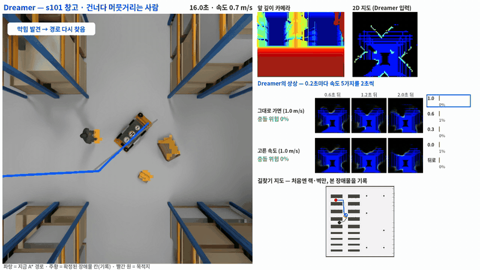<br>
<sub>보행자가 전방을 막자 "현재 속도 유지 시 위험 22%" → 정지 후 후진하여 보행자에게 양보 (전체 영상: <a href="media/videos/panel_dreamer_person_s101.mp4">panel_dreamer_person_s101.mp4</a>)</sub></p>

0.2초 주기로 다음 과정을 수행합니다.
1. 새 BEV 지도와 직전 행동으로 잠재 상태를 갱신합니다.
2. 속도 후보 **5개(1.0 · 0.6 · 0.3 · 0 · 후진 0.3 m/s)** 각각에 대해, 현재 경로를 해당 속도 이하로 추종하는 경우를 **2초(10단계)** 예측합니다. 미래의 불확실성을 반영하기 위해 후보마다 **8회** 샘플링하여 평균합니다.
3. 단계별 충돌 확률을 결합하여 **2초 내 충돌 확률** = 1 − Π(1 − 단계별 충돌 확률)을 계산합니다.
4. 학습 시 충돌 손실에 가중치를 주어 확률이 높게 출력되므로, 검증 데이터로 구한 Platt 보정으로 실제 발생 비율에 맞춥니다.
5. **충돌 확률 5% 미만인 후보 중 가장 빠른 속도**를 선택합니다. 모든 후보가 기준을 넘으면 예상 충돌 시점이 가장 늦은 후보를 선택합니다. 1.5m 정지 규칙은 최종 안전장치로 유지합니다.

1회 판단 시간: RTX 5090(시뮬레이터 동시 실행) 0.11초 · **Jetson AGX Orin 0.044초**.

## 9. 실험 결과

### 최종 평가 — 미학습 창고 5곳, 동일 270장면 × 2회

| 항목 | 대응 없음 (참고) | 규칙 기반 | **Dreamer** |
|---|---|---|---|
| 주행 횟수 | 360 | 540 | 540 |
| 무충돌 도착 | 18 | 493 (91.3%) | **506 (93.7%)** |
| 제시간 도착 | 18 | 153 (28.3%) | **183 (33.9%)** |
| 보행자·물체 충돌 / 랙 충돌 | 318 / 24 | 29 / 12 | **24 / 7** |
| 시간 초과 | 0 | 6 | 3 |

- 상황 유형별 무충돌 도착 (유형별 180회): 일반 통행 165 → 168 · 돌발 출현 160 → 166 · 통로 막힘 168 → 172
- **동일 장면 대응 비교:** 무충돌 도착 — 규칙 기반만 성공 13 · Dreamer만 성공 26 (McNemar p = 0.053) / 제시간 도착 — 17 대 47 (p = 0.0002)
- 양쪽 모두 도착한 480회 중 334회는 Dreamer가 먼저 도착 (부호 검정 p < 10⁻¹⁸). 위험한 상황에서만 감속하기 때문입니다.
- 재현성: 2회 실행 결과가 일치한 장면 — 규칙 기반 251 · Dreamer 258 / 270
- 제시간 도착 기준: 초기 계획 경로를 0.7m/s로 주행한 시간 + 10초 이내 도착

**요약: Dreamer는 규칙 기반과 동등한 안전성(유의 경계)을 보이며, 도착 시간은 유의하게 단축되었습니다.** 원본 수치: [results/v5c/](results/v5c/)

### 충돌 예측 성능 (AUROC, 2초 내 충돌)

| 데이터 | Dreamer | 거리 기준 (전방 통로 최근접 장애물) |
|---|---|---|
| 학습 창고 검증 231편 | 0.948 | 0.864 |
| FC — 풀필먼트 센터형 (미학습) 40편 | 0.979 | 0.805 |
| 자동 생성 101 (미학습) 40편 | 0.939 | 0.869 |
| 자동 생성 102 (미학습) 40편 | 0.988 | 0.883 |

AUROC 1은 완벽한 구분, 0.5는 무작위 수준을 의미합니다. 미학습 창고에서도 성능이 유지되어 **일반화 성능**을 확인하였습니다.

## 10. 주행 영상

동일 장면을 규칙 기반과 Dreamer로 각각 주행하고, 바닥 고정 카메라로 촬영한 비교 영상입니다. 동일 장면이라도 판단 시점에 따라 결과가 달라질 수 있으므로 **재현 횟수**를 함께 표기하였습니다.

| 영상 | 상황 | 재현 |
|---|---|---|
| [rule_vs_dreamer_forklift_s103.mp4](media/videos/rule_vs_dreamer_forklift_s103.mp4) | 방향을 전환하며 접근하는 지게차 — 규칙 기반은 충돌, Dreamer는 조기 정지 후 양보하고 통과 | 4회 중 4회 |
| [rule_vs_dreamer_person_s101.mp4](media/videos/rule_vs_dreamer_person_s101.mp4) | 횡단 중 머뭇거리는 보행자 | 7회 중 5회 (반대 결과 1회) |
| [rule_vs_dreamer_person_s102.mp4](media/videos/rule_vs_dreamer_person_s102.mp4) | 다수 작업자 사이, 정지 후 다시 걷는 보행자 | 4회 중 2회 (반대 결과 1회) |
| [rule_vs_dreamer_forklift_s104.mp4](media/videos/rule_vs_dreamer_forklift_s104.mp4) | 통로를 점유한 지게차 포크 — 규칙 기반 6/6 충돌, Dreamer 6/6 무충돌(4회 도착) | |
| [rule_vs_dreamer_s102_chase.mp4](media/videos/rule_vs_dreamer_s102_chase.mp4) | 랙 사이에서 출현하는 보행자 (추종 카메라, 중간발표 10장) | 최종 평가 1회차 기록 — 재실행 시 대부분 양쪽 모두 충돌 (재현율 낮음, 10회 중 1회) |
| [panel_dreamer_person_s101.mp4](media/videos/panel_dreamer_person_s101.mp4) / [panel_rule_person_s101.mp4](media/videos/panel_rule_person_s101.mp4) | 출발부터 도착까지 전체 주행 + 깊이 영상 · BEV 지도 · 예측 지도 · 속도별 위험 · 경로 계획 지도 | |
| [depth_to_bev_to_dreamer.mp4](media/videos/depth_to_bev_to_dreamer.mp4) | 깊이 영상 → 3차원 점 → BEV 지도 → Dreamer 입력 → 예측 과정 애니메이션 (실제 데이터·실제 모델 출력) | |
| [cosmos_fail_real_vs_imagined.mp4](media/videos/cosmos_fail_real_vs_imagined.mp4) · [rule_collision.mp4](media/videos/rule_collision.mp4) | Cosmos 예측 실패 사례 · 규칙 기반 충돌 사례 | |

<p align="center">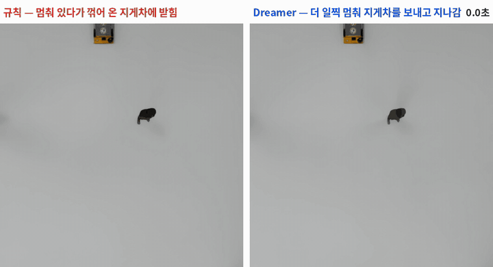</p>

## 11. 한계점

- **무충돌 도착률의 차이는 유의 경계**(p = 0.053)입니다. 따라서 "규칙 기반보다 안전하다"가 아니라 "규칙 기반과 동등한 안전성을 유지하면서 더 빠르다"로 해석해야 합니다.
- **최종 안전장치 없이 Dreamer만 사용한** 이전 버전은 규칙 기반보다 성공 횟수가 적었습니다(162장면 중 130 대 145, p = 0.011). 이에 따라 최종 구성은 Dreamer(속도 결정) + 1.5m 정지 규칙(최종 안전장치)입니다.
- **후진 데이터가 부족합니다** (전체 53만 단계 중 0.6%, 주로 좁은 공간 탈출 시). 후진 후보의 위험도는 다른 속도 후보보다 정확도가 낮을 수 있습니다.
- 시뮬레이터의 깊이 영상에는 잡음이 없습니다. 실제 카메라 적용 시 잡음 및 결측값 처리가 필요합니다.
- 학습 대상은 속도 결정에 한정되며, 진행 방향은 A* 경로 계획이 결정합니다.
- 최종 평가에는 상대 속도를 고려하는 기준 방식(등속 예측·TTC)이 포함되지 않았습니다. 해당 비교는 초기 단순 창고 실험에서만 수행하였습니다(횡단 보행자 30회 중 등속 예측 15회 · Dreamer 29회 성공).

## 12. 향후 계획

- **모델 고도화:** 상대 속도 기반 기준 방식(등속 예측)과의 비교 · 실패 사례 분석 · 이동 물체 정보 입력(직전 프레임 장애물 채널) · 후진·회전 데이터 보강 · 회피 동작 후보 추가 · 진행 방향까지 예측 공간에서 학습(원 Dreamer의 정책 학습 방식)
- **소형 실차 적용 (RC카):** 아두이노 기반 2모터 차량 + Jetson Xavier + 깊이 카메라 3대(전방 1대, 좌우 측면 각 1대, 후방 없음). 모델은 시뮬레이터에서 고도화하고, 차량 크기·카메라 장착 높이·카메라 사양에 맞춘 조정은 최종 단계에서 수행합니다.
- **Cosmos 활용 방안:** Dreamer가 예측한 BEV 지도를 사실적인 영상으로 변환하여 설명 및 시연에 활용

## 13. 저장소 구조 및 실행 방법

```
isaac/            Isaac Sim 코드
  build_wh.py       창고 자동 생성 (seed → warehouse.usda + env.json)
  build_fc.py       풀필먼트 센터형(FC) 창고 생성
  logistics.py      시뮬레이션 통합: 지도 생성 · 위험 상황 · 데이터 수집 · 평가 · 시연 · 영상
  nav.py            A* 경로 계획 · 경로 추종 · BEV 지도 생성 · 정지 규칙
src/
  wm_bev.py         Dreamer 학습 · 평가 · 주행 중 예측(Lookahead)
  rollout.py 외      Cosmos 실험 코드 (2절)
third_party/dreamerv3-torch/   DreamerV3 PyTorch 구현 (MIT, NM512)
scripts/vm/       실험 실행 스크립트 (수집 job17 · 학습 chain17 · 평가 job18 · 시연 demo.sh · 영상)
scripts/media/    영상·애니메이션 생성 코드
results/          결과 요약 (README · 수치 json · 학습 기록)
docs/             수식 정리 · Cosmos 실험 기록
media/            영상 · GIF · 그림
```

**실행 환경:** Ubuntu + NVIDIA RTX GPU, Isaac Sim 6.1 (pip 가상환경), PyTorch, numpy, scipy, pyyaml, pillow, matplotlib, ffmpeg.

```bash
# 1) 창고 생성 및 지도 작성 (랙·벽만 포함한 사전 지도 포함)
python isaac/build_wh.py --seed 1 --out ~/agv/wh/s001
python isaac/logistics.py --inspect --env ~/agv/wh/s001/env.json --out ~/agv/wh/s001
python isaac/logistics.py --inspect --racks-only --env ~/agv/wh/s001/env.json --out ~/agv/wh/s001

# 2) 학습 데이터 수집 (창고별, 경로가 없는 에피소드 제외)
python isaac/logistics.py --v5 --collect5 260 --first 11000 --env ~/agv/wh/s001/env.json --out ~/agv/wh/s001 \
    --map racks --swept --smooth --backout --real-motion --reach --data-dir wm_data5c

# 3) 학습 (전체 창고의 ep*.npz를 한 폴더로 모은 뒤 실행)
python src/wm_bev.py --train --data ~/agv/v5cdata --out ~/agv/wm_bev_v5c --steps 40000 \
    --cont-scale 2 --term-frac 0.3 --chan-off R --cams 4 --bev-margin 0 --val-max 100

# 4) 평가 (미학습 창고, 규칙 기반과 Dreamer를 동일 장면으로 비교)
python isaac/logistics.py --v5 --eval5 --backout --swept --smooth --real-motion --env ~/agv/wh/s101/env.json \
    --out ~/agv/wh/s101 --map racks --conds respond,wm --wm-ckpt models/wm_22000.pt \
    --hybrid --pathcand --escape --hyb-slow 2.5:0.6 --tau 0.05 --tag _final

# 5) 시연 (창고·출발지·목적지·상황을 선택하여 1회 주행, 실시간 화면은 AGV_STREAM_IP 설정)
bash scripts/vm/demo.sh
```

**학습된 가중치 및 예시 데이터:** [Release v0.1-midterm](https://github.com/KINN-CH/agv-dreamer-warehouse/releases/tag/v0.1-midterm)
- `agv-dreamer-v5c-model.zip` — `wm_22000.pt` + `config.json` + `train_log.json`(확률 보정값). 압축을 풀어 `models/`에 둡니다.
- `agv-dreamer-sample-data.zip` — 학습 데이터 예시 10개 에피소드(충돌 5 · 무충돌 5, 창고 s003). 전체 2,305개는 위 수집 명령으로 재생성할 수 있습니다.

```python
from pathlib import Path
import numpy as np, sys
sys.path.insert(0, "src")
import wm_bev
la = wm_bev.Lookahead(Path("models/wm_22000.pt"))       # config.json · train_log.json이 같은 폴더에
la.observe(bev, np.array([v, w], np.float32))            # 0.2초 주기: 64×64×3 BEV 지도와 해당 구간의 평균 행동
risks = la.risks([(s, 0.0) for s in (1.0, 0.6, 0.3, 0.0, -0.3)])   # 속도 후보별 (2초 내 충돌 확률, 예상 충돌 시간)
```

## 14. 관련 연구

- **DreamerNav** (UCL, *Frontiers in Robotics and AI*, 2025) — DreamerV3와 Isaac Sim 창고 환경에서 4족 로봇의 주행 정책을 예측 공간에서 학습한 연구로, 본 프로젝트와 가장 가깝습니다. 본 프로젝트는 경로 계획은 유지하고 **충돌 확률로 속도만 결정하는 안전 계층**으로 적용하였으며, 충돌 데이터를 의도적으로 생성하고, 보행자·지게차가 있는 미학습 창고 5곳에서 규칙 기반과 동일 장면으로 비교하였다는 점이 다릅니다. [논문](https://www.frontiersin.org/journals/robotics-and-ai/articles/10.3389/frobt.2025.1655171/full)
- **DreamerV3** (Hafner 외, 2023) — 구조의 출발점. [arXiv](https://arxiv.org/abs/2301.04104) · 구현 [NM512/dreamerv3-torch](https://github.com/NM512/dreamerv3-torch)
- **DREAMer-VXS** (2025) — 지상 차량 LiDAR 탐사를 위한 잠재 공간 월드모델. [arXiv](https://arxiv.org/abs/2512.00005)
- **SafeDrive Dreamer** (2024) — 자율주행 위험 상황 대응을 위한 월드모델. [논문](https://www.sciencedirect.com/science/article/pii/S1110016824011943)
- **NVIDIA Cosmos** — 범용 월드 파운데이션 모델 (2절 사전 실험 대상)

---

## 참여 인원

김철호 · 김준경 · 김민서 · 정윤찬

<sub>2026년 2학기 졸업 프로젝트 중간발표(10/12) 기준 결과입니다. 모든 수치는 위 폴더의 원본 기록에서 산출하였습니다.</sub>
